# Aztra's Forever UI

> **Version 0.97 Beta.** This addon was specifically designed for **Crusader-Storm**. It is a public beta: please report anything odd. [Download the latest version](https://github.com/byteme-entertainment/AztraForeverUI/releases/latest) · [Changelog](CHANGELOG.md)

**Make World of Warcraft: The Burning Crusade Classic look and play like Blizzard's *WoW: Forever UI*.**

Aztra's Forever UI is an addon for the **2.5.3** client. It redraws the interface in the style of Forever's modern HUD (bronze metal windows, red buttons, the round minimap, new action bars) and adds Forever's own **Edit Mode**, so you can move and resize the HUD the way the newer game does. It works on top of the client's own frames: clicks, drags, tooltips and secure actions stay Blizzard's.

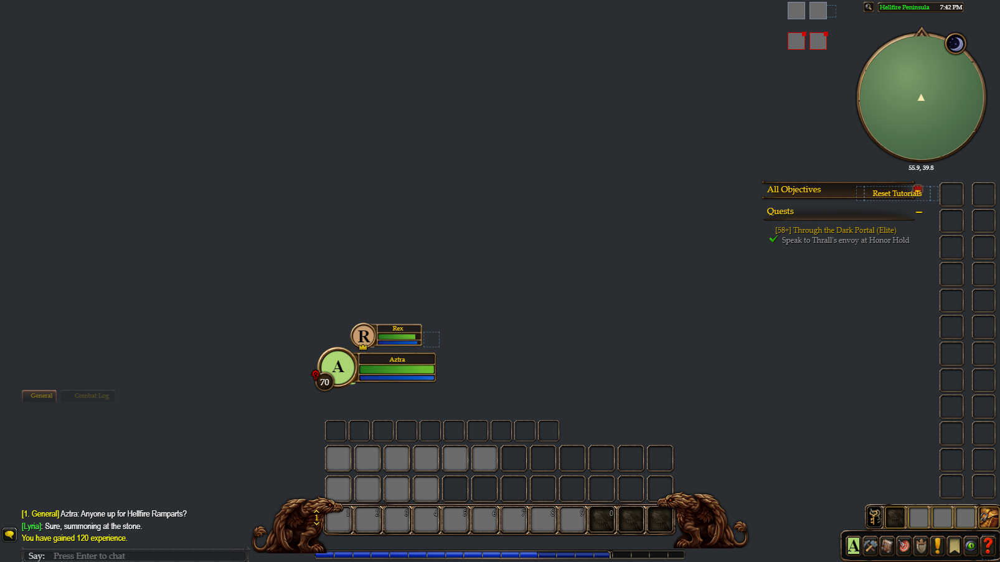

## What you get

| Area | What changes |
| --- | --- |
| **Unit frames** | Forever's player, target, focus, party and pet frames, cast bars, buffs and debuffs (28 px icons, time under each, dispel-coloured borders). |
| **Action bars** | Main bar, two bottom bars, two right bars, pet, stance and possess bars, XP and reputation bar, micro menu, bag bar (full row, single icon, or hidden). Key bindings, macro names, cooldown numbers, range tint, proc glow, action button effects. Quick Keybind Mode (`/afui keybind`). |
| **Nameplates** | Forever's plates with your own debuffs on enemy plates and a slightly larger target plate. |
| **Bags and bank** | Forever's bag windows, combined bags, new-item glow, item level on every slot, vendor price in tooltips, bank window. |
| **Character** | Character sheet with its panes (reputation, skills, PvP, pet), item level on gear. |
| **Professions** | A professions overview and Forever's crafting window with filters and the skill-up animation. |
| **Spellbook and talents** | Spellbook with an option to hide lower spell ranks; the talent window. |
| **Map** | The world map in a Forever window (windowed and maximized), your tracked quests as numbered pins, optional always-visible zoom buttons for the minimap. |
| **Quest log and tracker** | Forever's quest log, and an objective tracker. New quests are tracked automatically (switchable). Works alongside Questie. |
| **Social and guild** | Friends, Who, ignore list, guild roster and guild info, a guild communities style window. |
| **Group Finder** | A Forever styled look-for-group window. |
| **Chat** | Forever's chat window and tabs, timestamps, fading, a tab strip toggle, click a web link to copy it, **Copy Chat** window (`/copychat`). |
| **Tooltips, loot, game menu** | Forever's tooltip box and corner anchor, loot window, and the Esc game menu with a button for Edit Mode and for this addon's settings. |
| **Edit Mode** | Move, scale and snap frames; per-frame settings (for example **Show Portrait**); presets **Modern** and **Classic**; saved layouts you can create, copy, rename, delete, import and export. |
| **Quality of life** | Item level on bags and gear, vendor price in tooltips, a **Sell Junk** button at vendors (and an optional auto-sell), new-item glow, auto-track new quests, quest pins on the map, copy links from chat, Copy Chat, hide lower spell ranks, nameplate debuffs, a first-run setup wizard (recommended UI scale, nameplates, clash warnings). |

### New in the beta

| | |
| --- | --- |
| 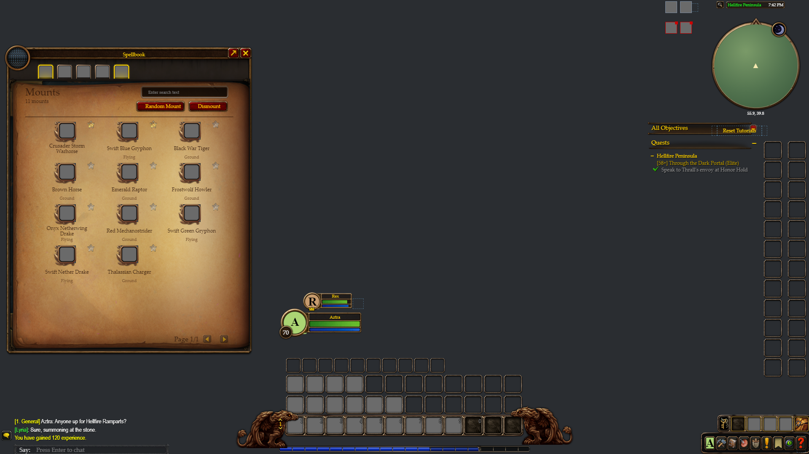 | 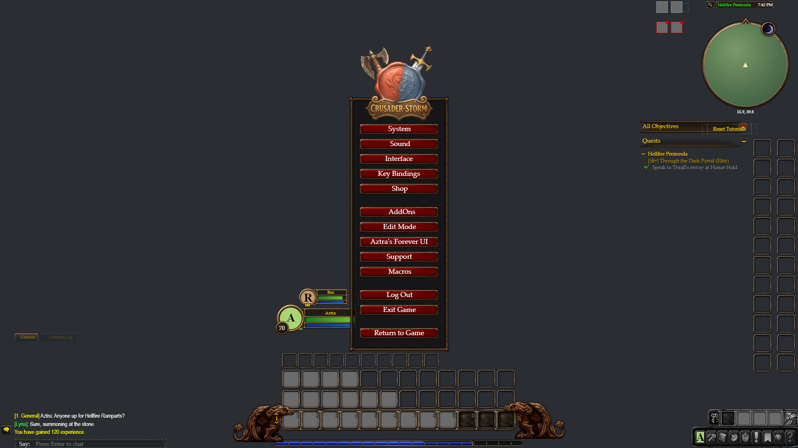 |
| 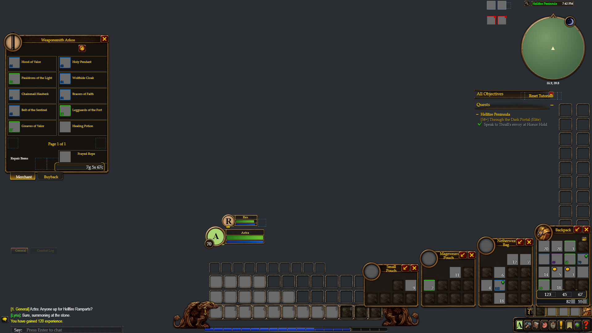 | 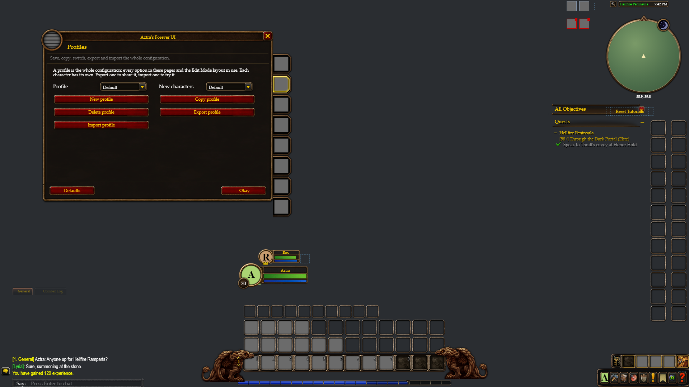 |
| 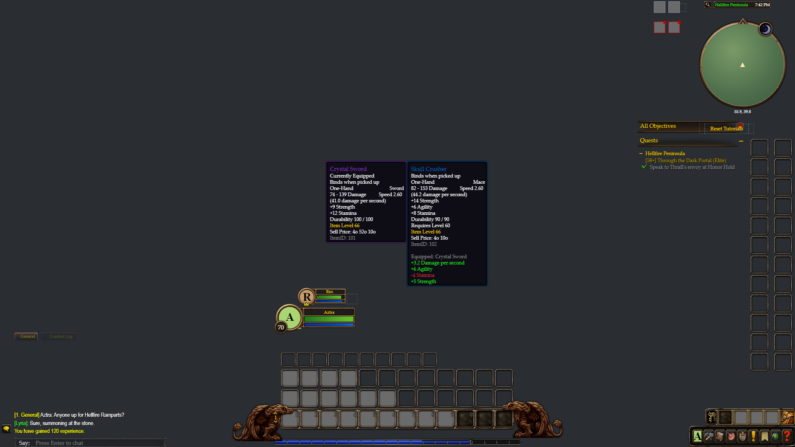 | |

These five are renders from a preview tool, not in-game captures (item icons show as grey squares there).

### A tour

| | |
| --- | --- |
| 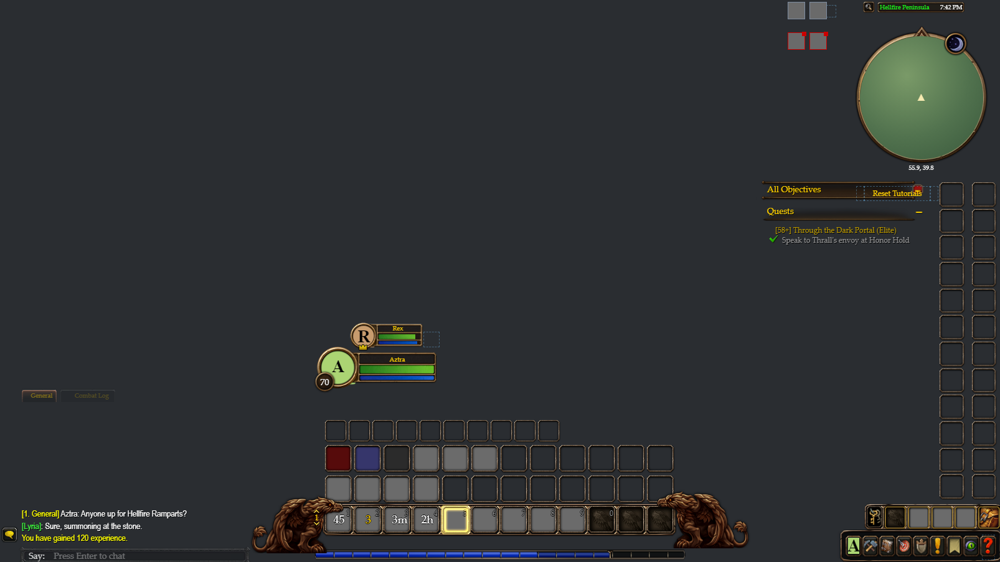 | 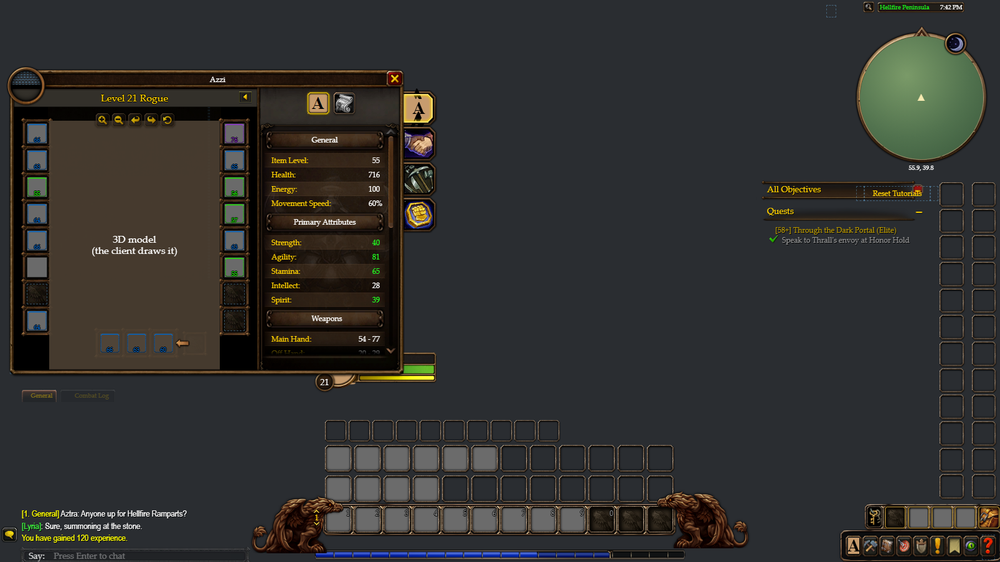 |
| 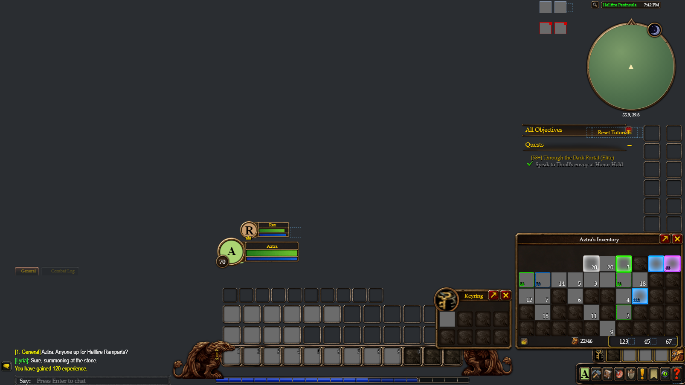 | 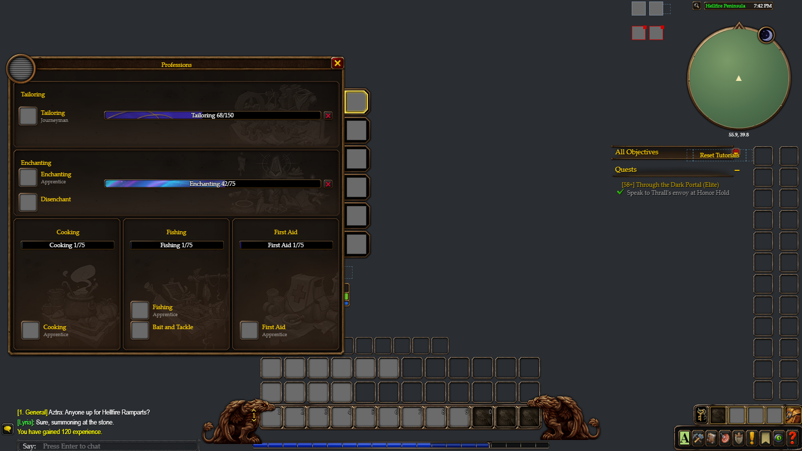 |
| 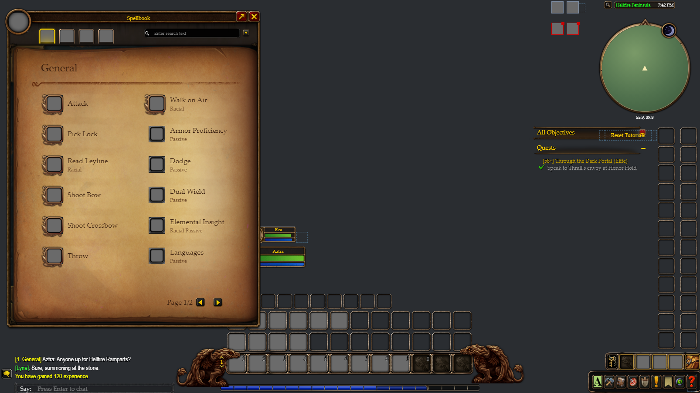 | 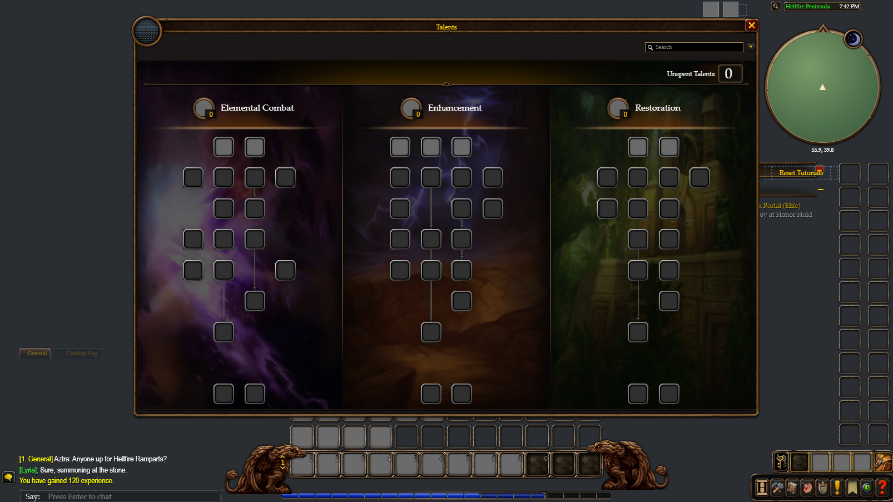 |
| 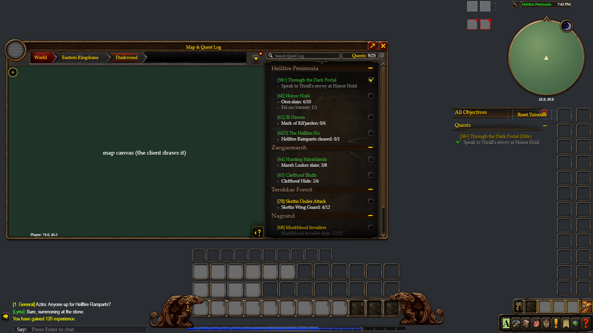 | 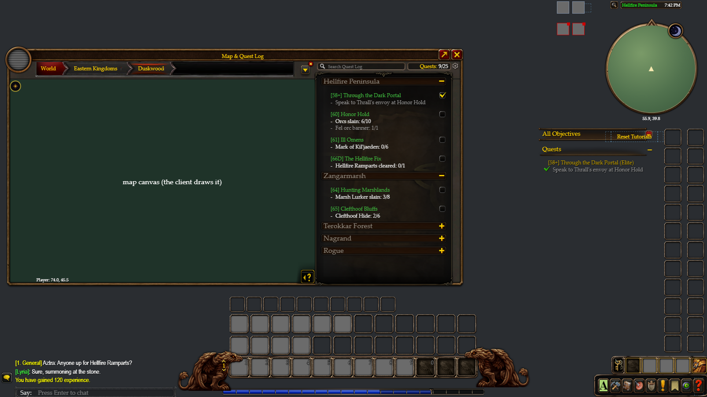 |
| 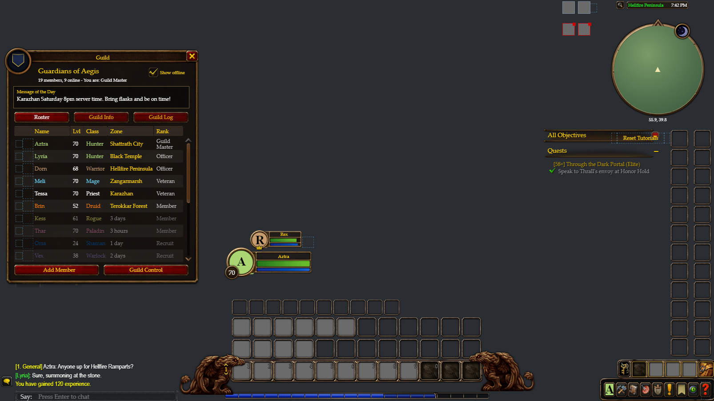 | 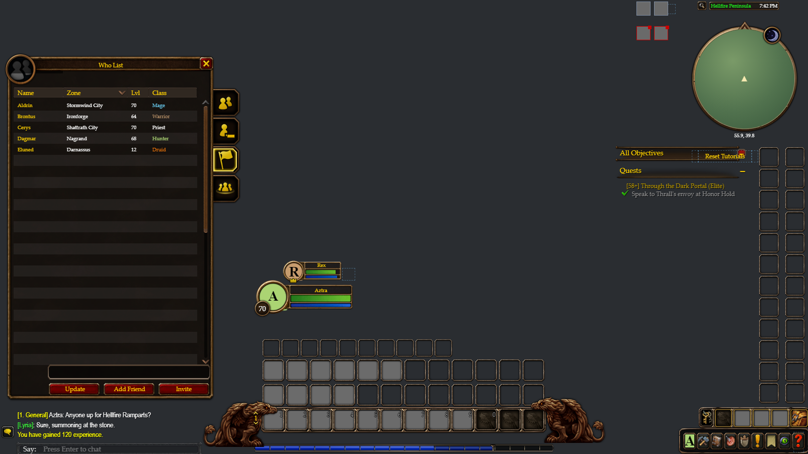 |
| 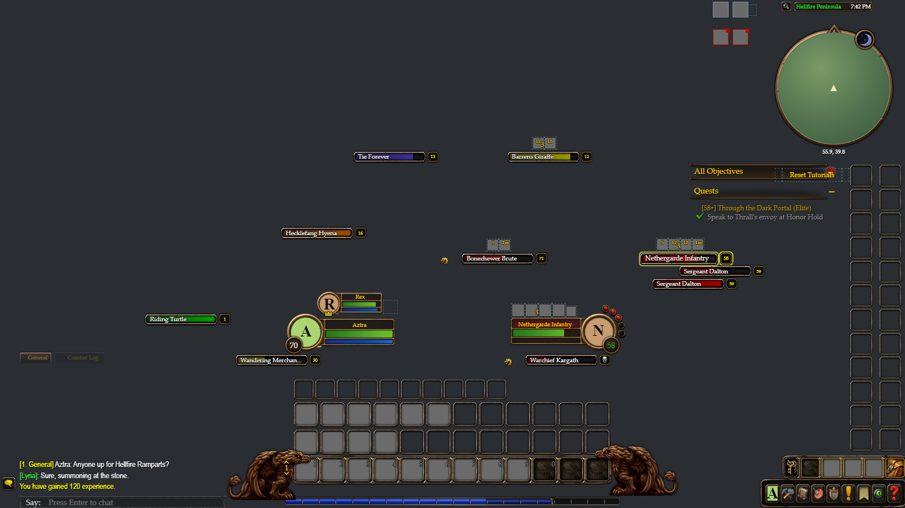 | 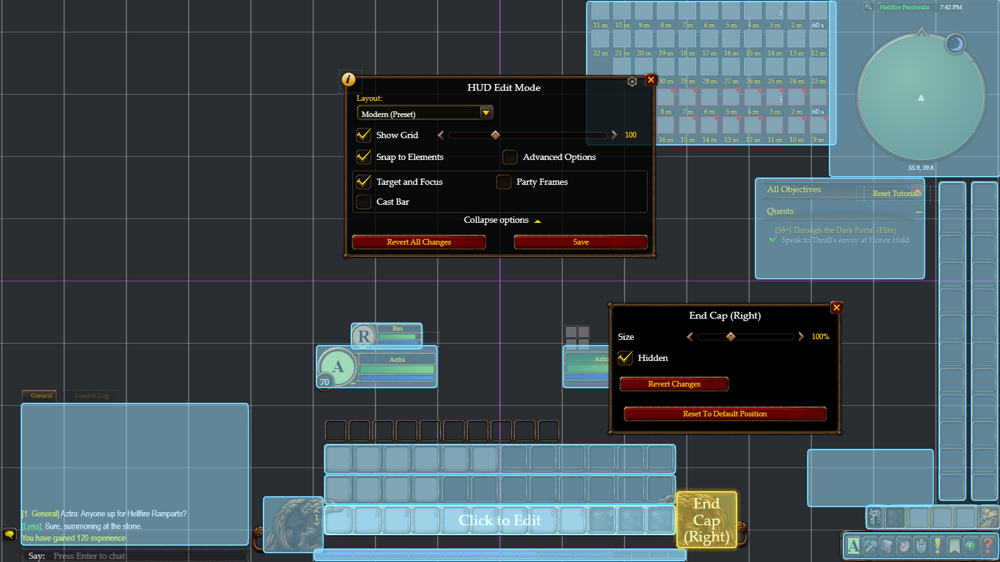 |

## Requirements

- **World of Warcraft: The Burning Crusade Classic client, version 2.5.3 (build 42328).** This is the only version it is made and tested for. Other builds, Classic Era or Wrath are not supported.
- No other addon is needed. **Disable action bar and bag addons** (Bartender4, Dominos, ElvUI, Tukui, Bagnon, ArkInventory, AdiBags, Baganator, Combuctor, OneBag3) for the characters that use this one: they draw the same things and clash. The addon warns you at login and in the setup wizard and never disables anything for you.

## Install

1. Download the latest zip and extract it.
2. Copy the **`AztraForeverUI`** folder into  
   `World of Warcraft\_classic_\Interface\AddOns\`  
   (the path ends `...\Interface\AddOns\AztraForeverUI\AztraForeverUI.toc`).
3. Start the game, or type `/reload` if you are already logged in. Make sure **Aztra's Forever UI** is ticked in the AddOns list on the character screen.
4. A welcome window appears on first login: apply the recommended UI scale and pick your nameplates.

More detail: [INSTALL.md](INSTALL.md).

## Using it

- **Settings:** `/afui`, the **Aztra's Forever UI** button in the Esc menu, or the gear in the Edit Mode dialog. Pages: General, Profiles, Action Bars, Chat, Tooltips & Bags, Nameplates, Tracker & Map, About. Every option takes effect at once, has a tooltip, and a page shows only what this build can honour.
- **Edit Mode:** `/editmode` or the Edit Mode button in the Esc menu. Pick **Modern** or **Classic** or a saved layout, drag frames, and use the per-frame settings. The dialog has New, Copy, Rename, Delete, Save and Revert.
- **Where your data is kept:** layouts live in `AztraForeverUIDB` (account) and `AztraForeverUICharDB` (per character), in your WTF folder. Window positions are kept per character.

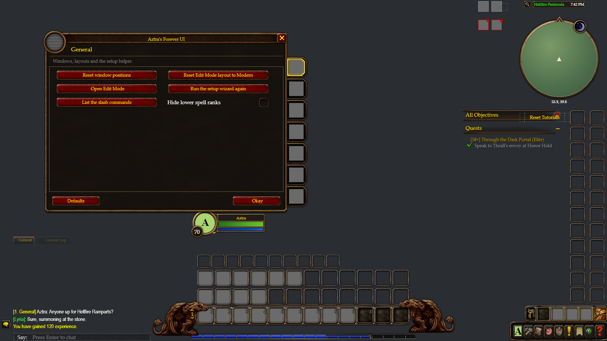

## Raid-style frames: aura filters

The raid-style party frames (Edit Mode > Party Frames > Use Raid-Style Party Frames) can show exactly the buffs and debuffs you care about, like ElvUI's filters but with a nicer way to build the lists. Open **Aura Filters** with `/afui filters`, from Settings > General, or with the **Aura Filters...** button in the Party Frames settings of Edit Mode.

- **Modes, per aura type (buffs, debuffs):** All, Only mine, Only list, All except list, Mine + list (your auras plus the list from anyone). Extras: only dispellable debuffs, always show boss debuffs, hide permanent buffs, hide buffs longer than N minutes, max icons, sort (Priority, Time left, Mine first, Aura order).
- **Lists:** a built-in starter set (Resto Druid HoTs, Priest, Shaman and Paladin, Raid defensive cooldowns, Raid utility buffs, Raid debuffs for the Burning Crusade raids) that you can copy and edit, and lists of your own: new, duplicate, rename, delete, export and import as text (`AFUIF1:...`). Each entry can be "mine only", have a priority and its own highlight colour. Spells match by id and by name, so every rank of a spell matches. Use one list on the whole account and another on a single character.
- **Adding spells:** type a name (suggestions from your spellbook and from the auras seen), type an id, add the auras on your target or the unit under the mouse, pick from the recently seen auras of you and your group, or drag a spell from the spellbook onto the list.
- **Look:** icon size, corner and growth direction, cooldown swipe, time left, stack count, border by debuff type, gold highlight for priority entries, and an optional outline of the whole frame when a debuff you can dispel is on a member.

Example: a Resto Druid picks the list *Healer: Resto Druid HoTs*, mode *Only list*: only your own Rejuvenation, Regrowth and Lifebloom show, so another druid's HoTs or a tank's pre-HoT never crowd the icons.

## Slash commands

| Command | What it does |
| --- | --- |
| `/afui` or `/afui config [page]` | Open the settings window (pages: general, actionbars, chat, tooltips, nameplates, tracker, about). |
| `/afui help` | List every command. |
| `/afui wizard` | Run the first-time setup again (UI scale, nameplates, clashing addons). |
| `/afui keybind` | Quick Keybind Mode: hover an action button and press a key. |
| `/afui npdebuffs` | Turn your debuffs on enemy nameplates on or off. |
| `/afui resetwindows` | Put every window back at its default spot. |
| `/afui questie` | Explain why Questie's tracker might not show. |
| `/afui audit [report]`, `/afui shots` | Developer tools: measure every window, or take a screenshot of each. |
| `/editmode` | Move and resize the HUD. |
| `/professions`, `/prof` | Open the professions overview. |
| `/copychat` | Open the Copy Chat window. |

## Known limitations

- **2.5.3 (build 42328) only.** Other client builds are not tested and may show errors.
- It re-skins the client's own windows. The client's options windows (Video, Sound, Interface, Key Bindings) stay as Blizzard made them.
- Some actions are protected by the game and cannot change in combat. Edit Mode and key binding changes wait until combat ends.
- Another addon that replaces the same frames (action bars, bags, unit frames) will clash.
- Not every Forever window exists in the Classic client, so some Forever features have nothing to attach to. Features of the modern game that the 2.5.3 client cannot do are not faked.
- The addon is large (about 80 MB), mostly textures.

## Windows: keep Blizzard's own where you prefer it

Every window or panel Aztra's Forever UI draws has its own switch under **Settings > Windows**, so you can keep Blizzard's version of just one window and use ours for the rest. **On** is Aztra's Forever UI's version (the default). **Off** is Blizzard's own window, completely native: none of our skins, hooks, key bindings, Esc menu buttons, tooltips or Edit Mode entries stay active for it. A change is read when the game starts, so the page shows "Waiting for a reload" and has a **Reload the UI to apply** button. **Use all Blizzard windows** and **Use all Forever windows** set every window at once (the HUD section keeps its own choice). If you turn the Game menu off, type `/afui` to open these settings.

| Section | Switches |
| --- | --- |
| Character & spells | Character window (C), Spellbook (P), Talents (N), Professions (K) |
| World & quests | Map & quest log (L), Objective tracker |
| Social | Friends, Who & Raid, Guild windows (G, J), Group Finder |
| Bags & vendors | Bags & Bank, Vendor window, Sell Junk button, Trainer window, Mailbox (beta), Auction house (beta), Loot window, Loot roll windows |
| Dialogs & menus | Dialogs & dropdown menus, Game menu (Esc) |
| HUD | Minimap, Buffs & debuffs, Action bars, Unit frames, Party frames, Nameplates, Chat, Tooltips |

The mailbox and the auction house are still beta and start **off**; everything else starts **on**. Your older choices (the mailbox, auction house, dialogs and loot roll options that were on the General page) carry over. Bags and the bank share one switch, and so do the unit frames and the cast bars.

## Compatibility

Aztra's Forever UI replaces a lot of the interface, so it knows about the addons that draw the same things. Nothing is ever disabled behind your back, and nothing of another addon's is touched.

**Clashes: you choose, and a fresh install never fights.** Under **Settings > Compatibility** there is one switch per part that other addons also draw. A switch tells Aztra's Forever UI whether to draw that part at all:

| Switch | Aztra's Forever UI draws | Gives way by default to |
| --- | --- | --- |
| Bags & Bank | the combined bags and bank windows | Bagnon, ArkInventory, AdiBags, Baganator, Combuctor, OneBag3, ElvUI, Tukui, LUI |
| Action bars | the bars, XP bar, menu and bag buttons, end caps, bar keys | Bartender4, Dominos, Neuron, ElvUI, Tukui, LUI |
| Unit frames | player, target, pet and party member frames, cast bars | ShadowedUnitFrames, PitBull4, ZPerl, Luna, ElvUI, Tukui, LUI |
| Party frames | the raid-style party frames | Grid, Grid2, VuhDo, HealBot, ShadowedUnitFrames, PitBull4, ZPerl, Luna, ElvUI, Tukui, LUI |
| Chat | the chat window skin and chat extras | Prat, Chatter, Glass, ElvUI, Tukui, LUI |
| Nameplates | plates over units and the debuff row | TidyPlates, Plater, Kui Nameplates, ElvUI, Tukui |
| Map & quest log | the world map window and the L key | Mapster, Cartographer |
| Tooltips | the tooltip skin and the lines it adds | TipTac, ElvUI, Tukui, LUI |

Every switch is **on** by default, **except** that a part starts **off** while an addon from its row is loaded and you have not chosen yet. At login you get one chat line saying which addon is loaded and what both of you draw, once per character (the page has a button to show it again). A change shows after `/reload`. Info bars (Titan Panel, FuBar) and BagBrother (data only) are listed and never clash.

**Works together.** These need no setting; `/afui compat` shows what was done:

- **ItemRack:** its minimap button stays above our minimap ring.
- **Pawn:** its tooltip lines keep their place; our Item Level and ID lines come after them and never twice.
- **Questie:** Questie's frames are never touched; our tracker steps aside while Questie's tracker is on (`/afui questie` explains the rest).
- **Outfitter:** its panel is moved clear of the character window's tabs.
- **OmniCC:** it draws the cooldown numbers on our buttons and ours stay off, so nothing shows twice.
- **Masque / ButtonFacade:** our buttons keep the standard parts (Icon, Cooldown, Count, HotKey, Name, Border, NormalTexture, FloatingBG) and a button they skinned is not skinned again by us.
- **DBM, BigWigs, Details, Recount, Skada, WeakAuras:** they anchor to frames we keep in place; nothing is changed, and the report lists what they will find.

**Reporting a problem.** Type `/afui compat` and paste the lines it prints into your report. It lists each known addon that is loaded (name, version, state, what we did), the state of the switches and the frames involved. Say what you expected and what you saw.

## Credits

Thank you for using Aztra's Forever UI. Made with love by Aztra, specifically designed for Crusader-Storm.

## Rights

All rights reserved. (c) 2026 ByteMe Entertainment.

World of Warcraft and Forever UI artwork are property of Blizzard Entertainment. This project is a fan made addon and is not affiliated with or endorsed by Blizzard Entertainment.
